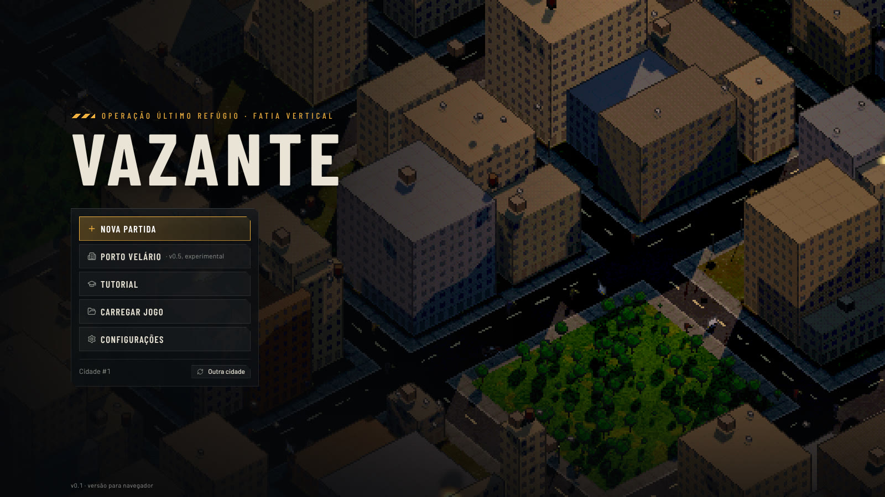
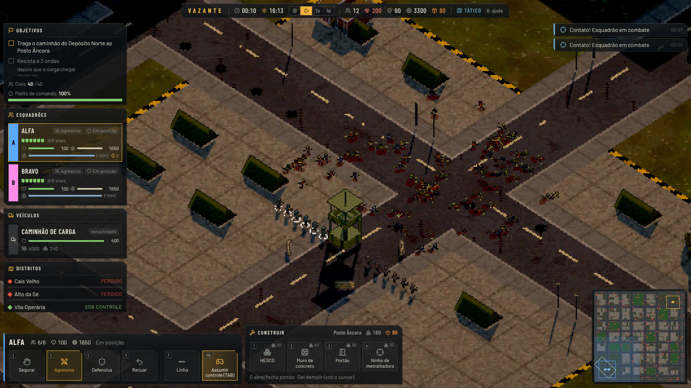
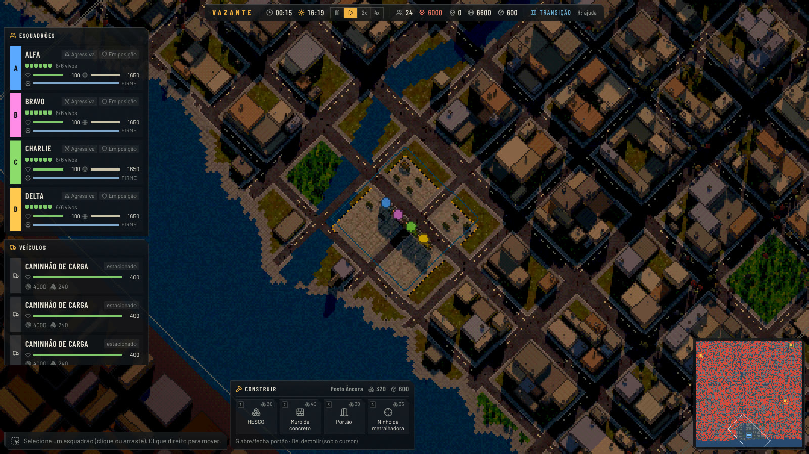
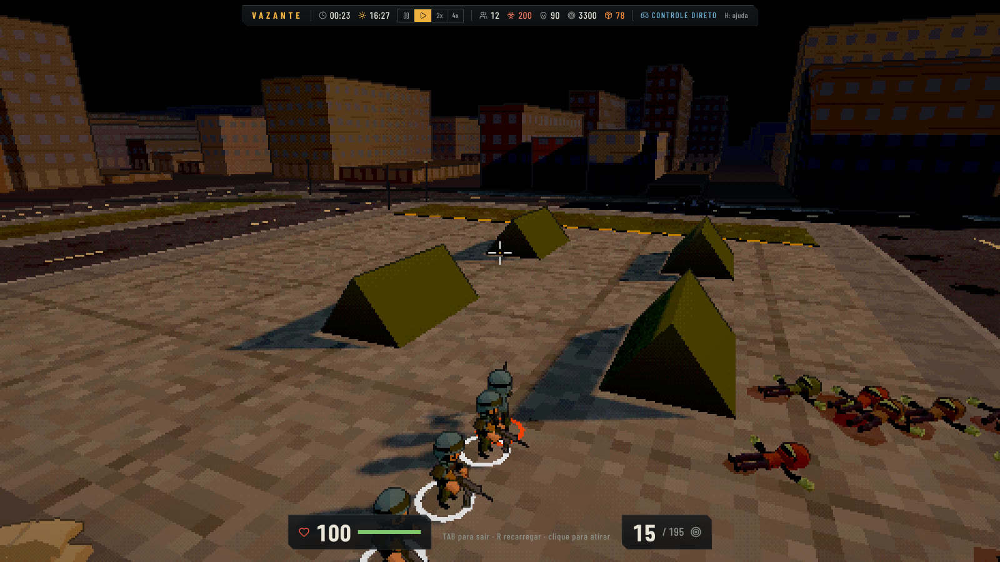

<p align="center">
  
</p>

<h1 align="center">Vazante</h1>

<p align="center"><strong>One city. One horde. Every street is yours to hold.</strong></p>

<p align="center">
  <a href="https://gamestudio42.github.io/vazante/"></a>
  <a href="https://github.com/gamestudio42/vazante/actions/workflows/pages.yml"></a>
  <a href="https://github.com/gamestudio42/vazante/stargazers"></a>
  <a href="https://github.com/gamestudio42"></a>
</p>

<p align="center">
  A real-time strategy and survival game against a city-sized zombie horde, in the browser.
  Plan on the operations map, zoom into any street to fight, or take direct control of a soldier,
  all in one persistent simulation. Escort the trucks, build the walls, and hold the waterfront
  until the tide turns. No installation is needed to play.
</p>

<p align="center">
  <a href="https://gamestudio42.github.io/vazante/">
    
  </a>
</p>

<p align="center">
  <a href="https://gamestudio42.github.io/vazante/">
    
  </a>
</p>

## Hold the city

1. **Read the map.** Porto Velário is two kilometres from the hills to the bay: six districts, a
   river, bridges and thousands of infected that follow noise. Zoom out to plan, zoom in to fight.
   It is one simulation at every scale, never a separate battle screen.
2. **Command the squads.** Order moves, stances and formations. Soldiers spread their fire, slow
   the dead with hits, look for cover when holding, and crack under stress: a panicking soldier
   stops shooting and runs.
3. **Keep the supplies moving.** Trucks carry ammunition and materials between depots and bases.
   The engine draws the horde, so choose the route and what the driver does when blocked.
4. **Fortify.** Lay HESCO lines, concrete walls, gates and machine-gun nests, then survive the
   waves the Choir sends against the base.
5. **Take the rifle.** Press `TAB` on a squad and fight a soldier's battle in third person, then
   give control back without leaving the same world.

Three difficulty levels and a guided first game are on the briefing. The horde is deterministic:
the same seed and orders always play out the same way, so saves are exact.

## See the fight

<p align="center">
  
</p>

<table>
<tr>
<td align="center" width="50%" valign="top">
<br>
Porto Velário: four squads and three trucks on the 2 km city.
</td>
<td align="center" width="50%" valign="top">
<br>
Direct control: one soldier, the same battle.
</td>
</tr>
</table>

## Play

Open **[gamestudio42.github.io/vazante](https://gamestudio42.github.io/vazante/)**. Choose
**Campanha** for the four missions (each win opens the next), **Nova partida** for the first one
or **Porto Velário** for the full city sandbox, pick a difficulty and start.
The interface is in Portuguese by default; English is in Settings.

| Action                     | Shortcut                                        |
| -------------------------- | ----------------------------------------------- |
| Pan / rotate / zoom        | `WASD` or arrows / `Q` `E` / wheel              |
| Operations map             | `M`                                             |
| Select / move              | left click or drag / right click                |
| Stance                     | `Z` hold · `X` aggressive · `C` defensive · `V` withdraw |
| Formation                  | `F` cycles line, column, wedge, circle          |
| Pause / speed              | `Space` / `F1` `F2` `F3`                        |
| Direct control             | `TAB` (mouse aim, click fire, `R` reload)       |
| Build / gate / demolish    | `B` then `1–4` / `G` / `Del`                    |
| Quick save / load          | `F5` / `F9`                                     |
| Menu / sound               | `Esc` / `N`                                     |

Games save in the browser. A desktop build (Electron) runs the same game offline.

## Develop

Requires Node.js 22+ and pnpm 10.

```sh
pnpm install
pnpm dev        # http://localhost:5173
```

| Command        | Purpose                                                   |
| -------------- | --------------------------------------------------------- |
| `pnpm check`   | Type check, lint, unit and simulation tests               |
| `pnpm e2e`     | Playwright browser tests                                  |
| `pnpm sim`     | Headless run of the mission with a state hash             |
| `pnpm bench`   | Simulation tick times, from 200 to 8,000 zombies          |
| `pnpm desktop` | Build and open the Electron desktop app                   |
| `pnpm audio`   | Rebuild the sound clips from the CC0 sources (needs ffmpeg) |

Every push to `main` runs the checks and publishes `apps/game/dist` to GitHub Pages. The build
uses relative paths, so it runs from any folder.

The simulation is deterministic and runs in a Web Worker; the Three.js view and the React
interface only send commands and read frames. See the [game design](docs/GDD.md),
[architecture](docs/ARCHITECTURE.md), [roadmap](docs/ROADMAP.md), [balancing](docs/balancing.md),
[benchmarks](docs/benchmarks.md), [decisions](docs/DECISIONS.md) and [rules for agents](AGENTS.md).

## Licence

Vazante is free software under the GNU Affero General Public License, version 3 or any later
version ([`AGPL-3.0-or-later`](LICENSE)), following the
[Game Studio 42](https://github.com/gamestudio42) default for complete games. If you run a modified
version for other people, including as a website or over a network, you must offer them its source
under the same licence. Copyright (c) 2026 Marcel Savegnago. Releases up to commit 9c3ae92 were published
under MIT and remain available under those terms.

Its code, city, procedural art and music are original; the game is
mechanically inspired by Ebbtide, and no code or assets were copied. Third-party models, sounds,
fonts and icons keep their own licences (CC0, OFL or ISC), each listed in the [asset register](docs/assets.md).
See [LICENSE](LICENSE) and [AGENTS.md](AGENTS.md) for project rules.
